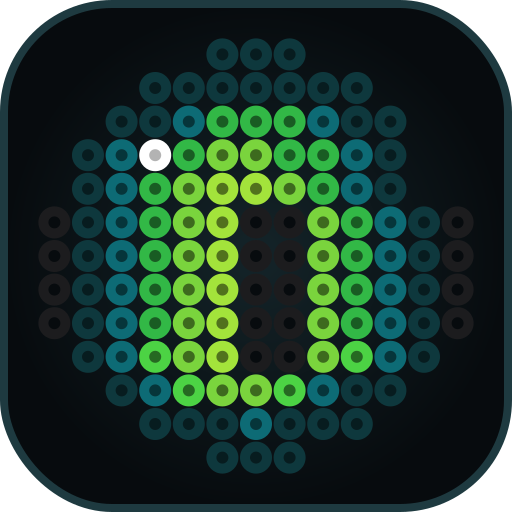
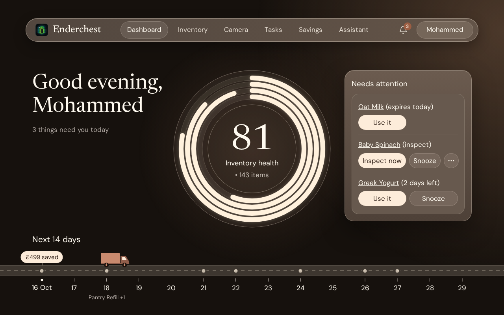
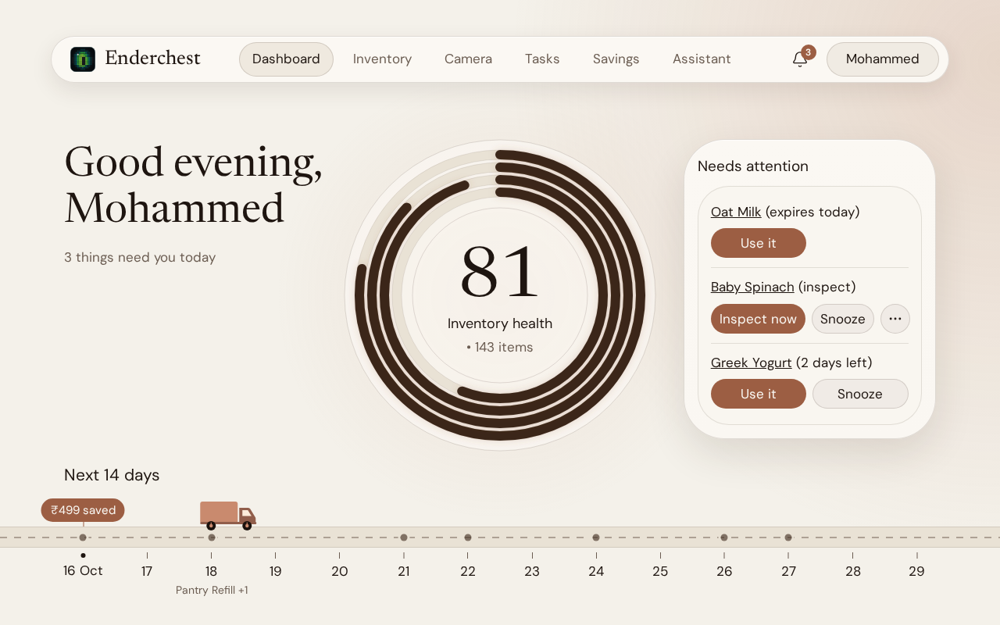
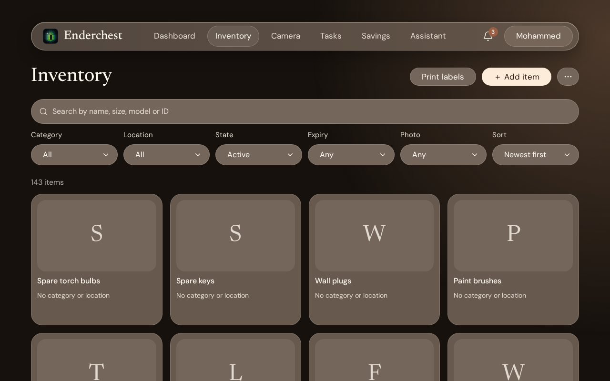
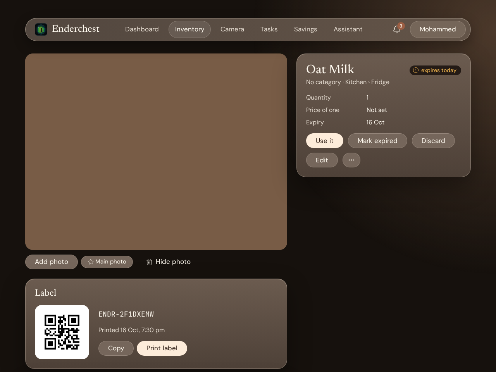
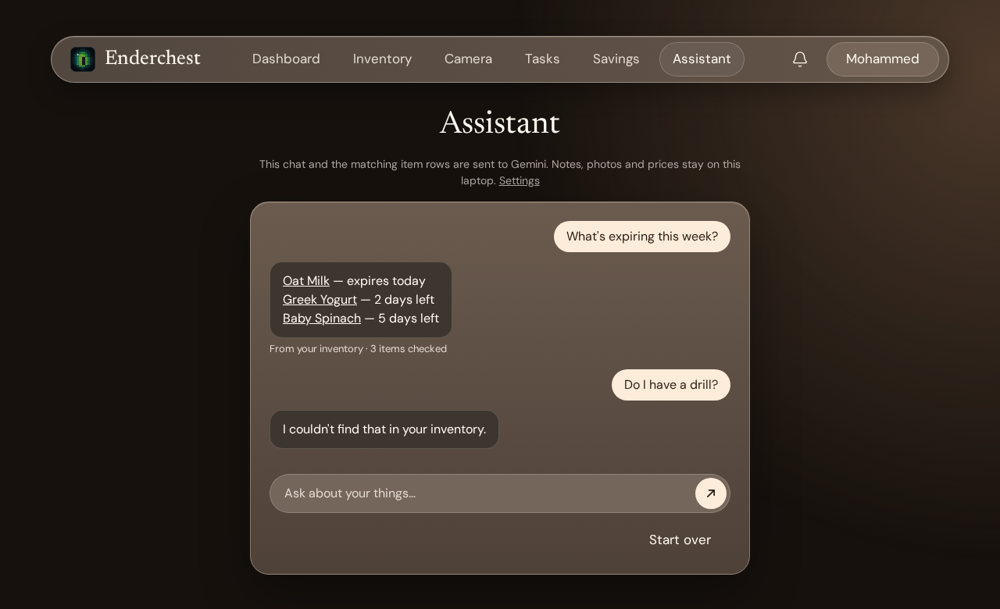
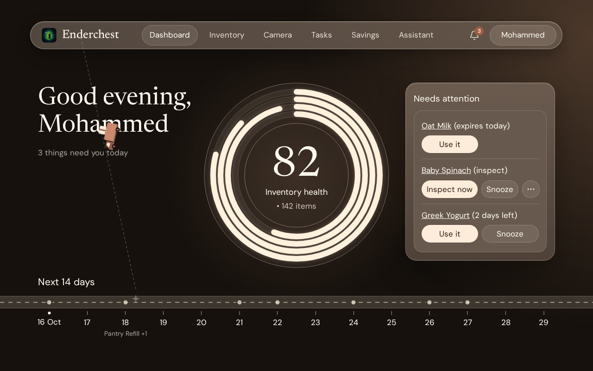
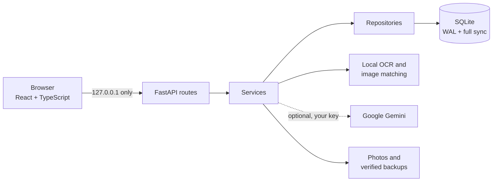

<p align="center">
  
</p>

<h1 align="center">Enderchest</h1>

<p align="center">
  <strong>A camera-driven personal inventory and maintenance app that runs on your own laptop.</strong><br>
  Photograph your things. Know what you own, what is about to expire, and what needs a look.
</p>

<p align="center">
  
  
  
  
  
</p>



<p align="center"><em>Screenshots show sample data from the test stack. A new install starts empty.</em></p>

## Why it exists

Most of what we own lives in cupboards and memory: the spare charger you bought twice, the milk that quietly expired, the drill nobody has checked in years. Enderchest gives each thing a record and a QR label, then answers three everyday questions:

- **Do I already own this?** Check before you buy.
- **What is about to expire or needs an inspection?** See it before it becomes a problem.
- **Where is my stuff?** Keep it organised without a spreadsheet.

The ideas are borrowed from industrial maintenance and quality management (the plant maintenance and quality management modules of SAP), scaled down to one person's home. Enderchest is **inspired by** SAP. It is not SAP software and is not connected to it.

## What it does

| | |
|---|---|
| **Add by camera** | Photograph an item. Local OCR reads the name, size, model number and expiry date, and you confirm every value before it counts. |
| **QR labels** | Every item gets a short public ID (`ENDR-` and 8 characters) and a printable label. The QR holds only that ID, never a URL or item data. |
| **Inventory** | Search names, brands, models and notes. Filter by category, nested location, state and expiry. |
| **Health dashboard** | Inventory health rings, a Needs attention list, and the next 14 days drawn as a road. |
| **Lifecycle and maintenance** | Use, expire or discard items with an audit trail. Plan inspections per item, worded as "inspection suggested", never "replacement required". |
| **"Do I own this?"** | A desk-side check: text and fuzzy matching first, image similarity only to add candidates, ranked with a confidence. You decide; it never claims certainty. |
| **Savings** | When you confirm "I didn't buy it" and type the price, the rupees you saved are counted. Nothing is estimated. |
| **Reminders** | An in-app notification centre, plus browser notifications while a tab is open. |
| **Assistant (optional)** | Ask about your things in plain words through Google Gemini, with your own key. It can only read, and an answer that names one of your items it did not look up in that turn is replaced. |
| **Backups you can trust** | Automatic, verified backups in a normal folder, with double-click scripts to back up and restore. |

## A look around

| Light theme | Inventory |
|---|---|
|  |  |

| An item | The assistant |
|---|---|
|  |  |

| Saving an item |
|---|
|  |

## Install

You need **Windows 10 or 11**, internet for the first build, and about **12 GB of free disk space**. Chrome or Edge works best, and a webcam (or a phone used as a webcam) is needed for the camera features.

Enderchest runs inside Docker Desktop, and `build.bat` installs it for you. **On a new PC, the restart and the Docker sign-in below are required. There is no other way to run it.**

1. **Get Enderchest.** On GitHub choose **Code**, then **Download ZIP**, and unzip it on **any drive, in any folder you will keep**. (Or use `git clone`.)
2. Double-click **`build.bat`**, type **Y**, and approve the Windows permission prompts.
3. **Restart Windows** when the window tells you to. This is normal, not a failure.
4. Open **Docker Desktop**, accept its terms, and **sign in** (a free account is enough). Wait until it says the engine is running.
5. Double-click **`build.bat`** again. **This can take 10 to 15 minutes and may look stuck. It is only downloading and building, and it is safe.** Do not close the window. Wait for "Build finished".
6. Double-click **`run.bat`**. Your browser opens the app at http://127.0.0.1:8470.

**If the page says it found an earlier copy of your data:** this can appear even on a first install. If you have nothing to restore, open **Start empty anyway**, type `START EMPTY`, and press **Start empty**. If you do have data you want, restore a backup there instead.

From then on you only need `run.bat`, which also starts Docker if it is stopped.

| Script | What it does |
|---|---|
| `build.bat` | Builds the app. Safe to run again; it never deletes anything. |
| `run.bat` | Starts Enderchest and opens it. |
| `stop.bat` | Stops it. Your data is untouched. |
| `backup.bat` | Makes and verifies a backup right now. |
| `restore.bat` | Lists your backups and restores the one you pick, after copying your current data to a safety backup. |

To change the port or the backup folder, edit the `.env` file that `build.bat` writes next to it. There is no login: the first run just asks your name and time zone.

If something fails, the window stays open and `build.bat` and `run.bat` save everything they print to a `.txt` file in the `logs` folder.

This install has been run on the developer's PC and on one second Windows 11 laptop that started without Docker (that laptop did hold an earlier backup). A completely clean PC has not been tested.

### Optional: the Assistant

The Assistant needs your own free Google Gemini key:

1. Open [Google AI Studio's API keys page](https://aistudio.google.com/apikey) and sign in with Google.
2. Create an API key and copy it.
3. In Enderchest, open **Settings → Gemini**, paste the key and save it.
4. Press **Test connection**, then switch on **Use the assistant**.

Gemini can take up to 60 seconds to answer on a slow connection, so please wait.

### Your data

- Your inventory lives in a Docker volume named `enderchest_data`, so it does not depend on the folder or drive you installed to. Moving or re-unzipping the app keeps your data.
- Backups go to `%USERPROFILE%\Enderchest-Backups` by default.
- **Never** run `docker compose down -v` or `docker volume prune`, delete that volume, or use Docker Desktop's "Clean / Purge data" or "Reset to factory defaults". Each of these deletes your inventory.

## Privacy

Everything runs on your computer, and the app is published on `127.0.0.1` only. It works with no internet and no account.

Gemini is optional and off until you add your own key in **Settings → Gemini**. When it is on, the screen says what leaves your computer. The assistant sends your question and the matching items' IDs, names, categories, places, quantities and expiry words. **Notes, prices and photos never go through the assistant.** When you ask what something cost, the page shows the saved price itself, read on your laptop after Gemini has answered. Reading a photo with Gemini is a separate setting.

## How it is built



| Layer | Choice | Why |
|---|---|---|
| Backend | Python, FastAPI, one process | Small and easy to explain; layers run routes → services → repositories → database |
| Database | SQLite with numbered SQL migrations, no ORM | One file that is easy to back up, with a verified backup before every migration |
| Frontend | React, TypeScript (strict), Vite | Typed from the backend's OpenAPI description |
| OCR and matching | Pretrained models on the CPU, baked into the image | Works offline on an ordinary laptop |
| Packaging | Docker Compose and `.bat` scripts | With Docker Desktop installed, a double-click builds and starts everything |

## Repository map

```
backend/app/      FastAPI app: routes, services, repositories, migrations, OCR, Gemini client
frontend/src/     React screens, patterns, design tokens
tests/e2e/        Playwright specs: flows, contrast, dead controls, motion
backend/tests/    Unit and integration tests, and PowerShell probes of the real scripts
release/          The file list and README for the slim zip other users get
docs/             Specs, data model, API, design, decisions, verification reports, logs
assets/logo/      The logo and icons
```

Worth reading: [the decisions log](docs/DECISIONS.md), [the data-safety contract](docs/DATA_SAFETY.md), [the screen specs](docs/PAGES.md) and [the verification reports](docs/reviews/).

## Testing

```bash
test.bat lint
test.bat unit
test.bat integration
test.bat e2e
test.bat probes
```

Everything runs in containers against a separate test stack on its own port and volume, never against your real data. The end-to-end suite includes a crawler that fails on any control that does nothing, and contrast checks on every screen. The probes exercise the real scripts: restarts, moving the folder, installing from a path with spaces and brackets, backup and restore.

## Status

The app is feature complete for its laptop scope. Each of the ten build phases was checked by a separate verification pass, and the reports are in [`docs/reviews/`](docs/reviews/).

A click-through on a fresh release install is recorded in [`docs/reviews/final-ux/`](docs/reviews/final-ux/). Still open: the checks that need real hardware or the owner (real camera and QR scanning, printing, uploading through the file picker, `restore.bat`'s prompts, and browser notifications), and an install on a completely clean PC. A website and phone version are out of scope for now. Windows is the only platform the scripts support.

## Contributors

- **[Mohammed Hasan Raza](https://github.com/mohammedhasanraza007)**: owner. Idea, product decisions, design direction and real-world testing, as a mechanical engineering student aiming at SAP QM/PM, for real daily use.
- **Claude** (Anthropic), through [Claude Code](https://claude.com/claude-code): co-worker. Wrote the code, tests and docs with Mohammed through a chain of build and verification sessions, all recorded in [`docs/logs/`](docs/logs/).
